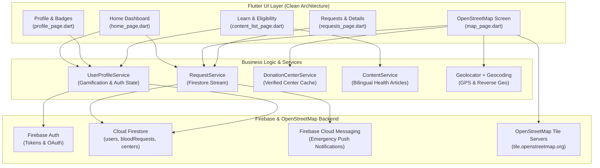
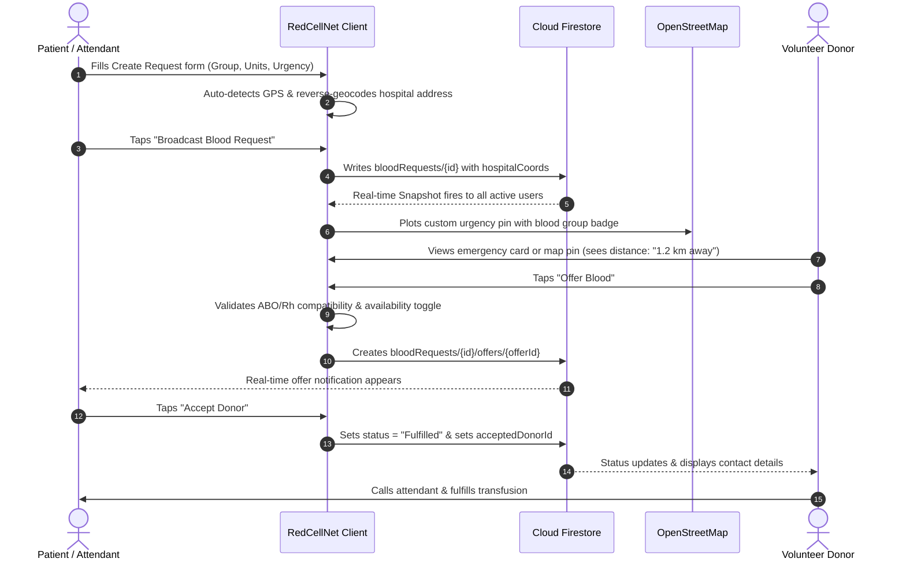

# 🩸 RedCellNet — Comprehensive Application Architecture & Design Guide

> **RedCellNet** is a modern, real-time blood donation and emergency network application built with **Flutter**, **Firebase**, and **OpenStreetMap (OSM)**. It bridges the critical gap between patients needing urgent blood transfusions and volunteer donors nearby.

---

## 📌 Table of Contents
1. [Application Purpose & Vision](#1-application-purpose--vision)
2. [What the Application Does](#2-what-the-application-does)
3. [How the Application Works (Architecture & Data Flow)](#3-how-the-application-works-architecture--data-flow)
4. [How It Looks: UI & Design System](#4-how-it-looks-ui--design-system)
5. [Screen-by-Screen Walkthrough](#5-screen-by-screen-walkthrough)
6. [Key Technical Components & Services](#6-key-technical-components--services)
7. [Security, Permissions & Offline Handling](#7-security-permissions--offline-handling)

---

## 1. Application Purpose & Vision

In medical emergencies—such as severe trauma, childbirth complications, surgeries, or thalassemia management—access to compatible blood within minutes is often the difference between life and death. Traditional blood banks frequently face shortages, and families resort to frantic phone calls and social media posts.

**RedCellNet solves this crisis by:**
1. **Instant Geolocation Matching**: Pinpointing patient locations and nearby volunteer donors on an open map.
2. **Biological Compatibility Engine**: Ensuring donors and recipients match both ABO and Rh factors before contacting.
3. **Structured Emergency Broadcasting**: Replacing messy social posts with structured alerts containing verified hospital coordinates, patient identifiers, units needed, and attendant contacts.
4. **Active Donor Standby Network**: Giving donors a 1-tap "Ready to Donate" toggle so emergency calls only go to available individuals.
5. **Community Gamification**: Encouraging lifelong donor habits through Life Points, tier rankings (*Bronze*, *Silver*, *Gold Guardian*), and achievement badges.

---

## 2. What the Application Does

```
+-----------------------------------------------------------------------------------+
|                                   REDCELLNET                                      |
+-----------------------------------------------------------------------------------+
|  🚨 Emergency Blood Requests   |  🗺️ OpenStreetMap Tracking  |  🩸 Biological Match  |
|  • Instant Broadcast Alerts    |  • Live Distance in km/m    |  • ABO & Rh Filtering |
|  • Urgency Level (Critical/Hi) |  • Hospital & Center Pins   |  • 1-Tap Handshake    |
|  • 1-Tap WhatsApp/SMS Share    |  • Embedded Mini Maps       |  • Acceptance Flow    |
+--------------------------------+-----------------------------+--------------------+
|  👤 Donor Standby Network      |  🏆 Gamification & Rewards  |  📚 Health & Awareness|
|  • 1-Tap Availability Switch   |  • Life Points (Reading/Log)|  • 60s Eligibility Q  |
|  • Smart OCR Card Scanner      |  • Rank Tiers (Gold/Silver) |  • Bilingual Guides   |
|  • Donation History Log        |  • 10 Achievement Badges    |  • Points per Article |
+-----------------------------------------------------------------------------------+
```

### Core Functional Pillars:
- **Emergency Broadcasting**: Anyone in need can post an emergency request specifying patient details, required blood group, units (bags), urgency level, hospital name, and contact information.
- **OpenStreetMap Exploration**: Visualizes all active emergencies and verified blood banks/donation centers on OpenStreetMap. Automatically computes physical distance from the user's current GPS position.
- **Donor Compatibility Validation**: Evaluates mathematical compatibility (e.g., `O-` can donate to anyone; `AB+` can receive from anyone; Rh-negative rules) so donors only commit to viable recipients.
- **Mutual Handshake System**: Compatible donors click "Offer Blood". The requester reviews all volunteer offers and accepts the best fit. Accepting an offer marks the request as **Fulfilled** and reveals direct contact lines.
- **Smart OCR Blood Report Scanning**: Users can photograph their physical blood test report or donor card; Google ML Kit recognizes the text and extracts the blood group automatically.
- **Gamified Engagement**: Users earn **Life Points** for reading educational articles (+1 pt), completing their profile (+15 pts), and logging blood donations (+10 pts). Badges unlock dynamically as milestones are reached.
- **60-Second Eligibility Quiz**: An interactive questionnaire that checks key health factors (age 18–65, weight > 50 kg, wellness, 90-day cooldown period) before a donor visits a hospital.

---

## 3. How the Application Works (Architecture & Data Flow)

### 3.1 Technology Stack
- **Framework**: Flutter 3.x (Dart 3.x) using Material 3 design principles.
- **Cloud Database**: Cloud Firestore (Real-time NoSQL streaming).
- **Authentication**: Firebase Authentication (Email/Password & Google Sign-In).
- **Push Notifications**: Firebase Cloud Messaging (FCM) + `flutter_local_notifications`.
- **Mapping & GIS**: `flutter_map: ^8.1.1` with `latlong2: ^0.10.1` backed by OpenStreetMap and CartoDB tile servers.
- **Device Geolocation & Geocoding**: `geolocator: ^12.0.0` and native platform `geocoding: ^3.0.0`.
- **Machine Learning (OCR)**: `google_mlkit_text_recognition: ^0.13.0`.

### 3.2 High-Level Architecture Diagram



### 3.3 Data Flow: The Life-Cycle of an Emergency Blood Request



---

## 4. How It Looks: UI & Design System

RedCellNet utilizes a **Material 3 + Modern Health** design aesthetic crafted for urgency, clarity, and trust.

### 4.1 Color Palette
- **Brand Crimson Primary** (`#E11D48`): A vivid rose-red symbolizing blood, life, and immediate emergency response.
- **Deep Burgundy** (`#9F1239`): Provides contrast for headers, text emphasis, and active indicators.
- **Soft Rose Mist** (`#FFF1F2` / `#FFE4E6`): Gentle background tint for blood group badges and active cards, preventing eye strain.
- **Medical Sky Blue** (`#0284C7`): Indicates verified healthcare facilities, donation centers, and secondary actions.
- **Status & Urgency Palette**:
  - **Critical**: `#DC2626` (Bright Red with pulsing glow)
  - **High Priority**: `#EA580C` (Vivid Amber-Orange)
  - **Moderate**: `#D97706` (Warm Goldenrod)
  - **Scheduled / Low**: `#059669` (Emerald Green)
- **Surfaces & Background**: Crisp `#FFFFFF` card containers on a subtle Slate `#F8FAFC` background.

### 4.2 Visual Elements & Micro-Interactions
- **Blood Group Badges**: Custom squircle containers with bold letterforms (`A+`, `O-`, etc.), subtle borders, and optional glow shadows for critical requests.
- **Pulsing Emergency Indicators**: Glowing animated indicators signaling real-time unfulfilled emergencies.
- **Layered Elevation**: Soft `BoxShadow` with alpha blends (`#0F172A` at 4–6% opacity) for a floating, lightweight feel.
- **Curved Geometry**: Rounded `16px` to `24px` borders across all cards, buttons, and bottom sheets.

---

## 5. Screen-by-Screen Walkthrough

### 5.1 Authentication (Login & Register)
- **Visuals**: Clean white canvas featuring the centered RedCellNet crimson droplet logo, subtle tagline (*"Connecting Donors • Saving Lives"*), and card-based form fields.
- **Functionality**:
  - Email and password sign-in with clear error reporting (e.g. invalid credentials, weak passwords).
  - One-tap **Google Sign-In** with branded Google icon.
  - Quick toggle to the Registration screen.
  - Password visibility toggle (`Icons.visibility_outlined`).

---

### 5.2 Home Dashboard (`home_page.dart`)
The operational cockpit of the application:
1. **Dynamic Greeting Bar**: Automatically calculates time of day (*"Good Morning ☀️"*, *"Good Afternoon 🌤️"*, *"Good Evening 🌙"*), displays user's name, verified avatar, and blood type badge.
2. **Instant Availability Switch**: A prominent card allowing donors to toggle between *"Ready for Donation"* (green pulse) and *"Currently Off-Duty"* in one click, without opening settings.
3. **Emergency SOS Card**: A high-contrast gradient hero card (*#FB7185* to *#9F1239*) with a pulsing SOS badge. Tapping immediately launches the *Create Blood Request* wizard.
4. **Interactive Blood Compatibility Matrix Tool**: A 1-tap launcher that opens an interactive sheet. Users can tap any blood group to see:
   - Who they can donate to.
   - Who they can receive from.
   - Universal donor (`O-`) and universal recipient (`AB+`) badges.
5. **Live Quick Filter Carousel**: Horizontal pills (`All`, `A+`, `A-`, `B+`, `B-`, `AB+`, `AB-`, `O+`, `O-`). Tapping any filter instantly refines the emergency list below.
6. **Urgent Emergencies Feed**: Live stream of open patient requests with remaining units, hospital names, relative timestamps (*"12m ago"*), and a quick *"Help"* button.
7. **Services Navigation**: Direct shortcuts to the OpenStreetMap view, Learn & Awareness library, and Compatibility Guide.
8. **Modern Bottom Navigation**: Floating white bar with custom indicator pills for *Home*, *Requests*, *Map*, *Profile*, and *Learn*.

---

### 5.3 OpenStreetMap Nearby View (`map_page.dart`)
Full-screen geospatial exploration powered by **OpenStreetMap**:
1. **Interactive OSM Canvas**: Smooth pan and multi-touch zoom with fast tile rendering.
2. **Search Bar**: Floating search field at the top to search hospitals, blood groups, or neighborhoods.
3. **Filter Pills**: One-tap toggles to display *"All Pins"*, *"Emergencies Only"*, or *"Verified Centers Only"*, with an embedded Blood Group dropdown.
4. **Dynamic Pins**:
   - **Emergency Pin**: Crimson circle showing blood group text (`A+`, `B-`, etc.) with a color-coded urgency dot.
   - **Center Pin**: Sky-blue medical clinic icon.
   - **User Location Beacon**: Cyan pulsing radar circle showing live device GPS position.
5. **Floating Action Controls**:
   - **Layers Button**: Switches between *OpenStreetMap Standard* and *Clean Light (CartoDB)*.
   - **Zoom Buttons**: `+` and `-` controls.
   - **Center on Me Button**: Smoothly animates the camera to the user's current GPS position.
6. **Interactive Bottom Sheet Preview**: Tapping any pin slides up an actionable card displaying:
   - Blood type needed or facility name.
   - Exact distance from user (e.g., *"1.8 km away"*).
   - Hospital street address.
   - Direct button: *"View Request & Help"*.

---

### 5.4 Blood Requests Center (`requests_page.dart`)
A triage and discovery hub for all blood requirements:
1. **Segmented Tabs**:
   - **All Open**: Every active community request.
   - **Critical & High**: Filtered view for emergency requests needed within hours.
   - **My Requests**: All requests created by the logged-in user.
2. **Live Search**: Instantly filters requests by patient note, hospital, city, or blood group.
3. **Comprehensive Filter Modal**: Select custom combinations of blood group and urgency level.
4. **Request Cards**: Shows blood badge with glow, urgency pill, units needed, time ago, hospital address, and details chevron.

---

### 5.5 Create Blood Request Wizard (`create_request_page.dart`)
A structured 4-step form designed for rapid data entry during stress:
1. **Step 1: Blood Group & Units**: Large touchable blood type pills. Selecting a blood group immediately shows a green notification listing compatible donor groups. Stepper buttons (`-` / `+`) adjust units needed (1 to 10).
2. **Step 2: Urgency Level**: Interactive cards with visual descriptions:
   - *Critical Emergency* (< 2 hours)
   - *High Priority* (6–12 hours)
   - *Moderate Need* (Today/Tomorrow)
   - *Scheduled* (Planned surgery)
3. **Step 3: Hospital & GPS Location**: Facility name input and street address. Includes a **"Pin Current GPS Location"** button that fetches the device coordinates and reverse-geocodes the address automatically.
4. **Step 4: Patient & Contact**: Patient identifier, attendant name, and verified phone number.

---

### 5.6 Request Details & Handshake (`request_details_page.dart`)
The bridge where donors and patients connect:
1. **Hero Header**: Large blood group badge (`60px`), urgency pill, status pill (*OPEN* / *FULFILLED*), units count, and timestamp.
2. **Donor Compatibility Banner**: Compares the logged-in user's blood group against the patient's and displays an explicit compatibility verdict.
3. **Embedded Mini OpenStreetMap**: Shows an interactive map snippet centered on the hospital with a custom pin.
4. **Share Request Button**: Copies a formatted emergency summary to the clipboard for instant sharing on WhatsApp, Telegram, or SMS.
5. **Action Bar**:
   - **Call / Copy**: Direct dialer shortcut.
   - **Offer Blood**: Launches the confirmation handshake flow.
6. **Offers Management (For Requester)**: Real-time list of volunteer donors. The requester can tap **"Accept"** (which marks the request fulfilled and shares phone numbers) or **"Decline"**.

---

### 5.7 Profile, Gamification & History (`profile_page.dart`)
Personal donor management and achievements:
1. **Donor Identity Card**: Displays donor initials avatar, display name, email, blood group badge, verified badge, and **Donor Tier Rank** (*Bronze Lifesaver*, *Silver Hero*, *Gold Guardian*).
2. **Live Stats Bar**: Life Points count and unlocked badges count.
3. **Availability Switch**: Second location to toggle donation standby mode.
4. **Personal Info Card**: Blood group, phone number, and city with an *"Edit Profile"* shortcut.
5. **Interactive Badges Showcase**: Grid of 10 badges (*First Drop*, *Rare Hero*, *Crisis Warrior*, *Legend Donor*, etc.). Tapping any badge reveals its unlocking criteria and points value.
6. **Donation History**: Tracked history of past donations with date, hospital name, and units donated. Includes a **"+ Log Donation"** button that awards `+10 Life Points`.

---

### 5.8 Edit Profile & Smart OCR Scanner (`edit_profile_page.dart`)
1. **Smart Blood Report OCR**: Allows users to take a photo of their lab report with the camera or upload from gallery. Google ML Kit scans the text, identifies ABO and Rh indicators (e.g. *"O Positive"*), and confirms setting it as the donor's blood group.
2. **Profile Inputs**: Editable fields for full name, contact number, city, and manual blood group selector.

---

### 5.9 Learn & Health Awareness (`content_list_page.dart` & `content_detail_page.dart`)
Educational portal promoting safe donor practices:
1. **60-Second Donor Eligibility Quiz**: Interactive modal checking 5 fundamental questions (Age, Weight, Symptoms, Surgery history, 90-day cooldown). Displays an instant green/amber verdict.
2. **Rewards Banner**: Informs users they earn `+1 Life Point` for every educational guide read.
3. **Category Chips**: Filter by *Eligibility*, *Preparation*, *Health Benefits*, and *Myths & Facts*.
4. **Article Detail View**: Clean typography with optional header imagery, read time indicator, and automated background points attribution via Firestore transaction.

---

## 6. Key Technical Components & Services

| Service / File | Purpose & Responsibilities |
| :--- | :--- |
| [`app_theme.dart`](file:///e:/Projects/RedCellNetApk/RedCellNet/lib/core/theme/app_theme.dart) | Design system tokens: `AppColors`, Material 3 theme configurations, custom box shadows, and gradients. |
| [`common_widgets.dart`](file:///e:/Projects/RedCellNetApk/RedCellNet/lib/core/widgets/common_widgets.dart) | Core reusable UI components: `BloodGroupBadge`, `UrgencyChip`, `SectionHeader`, `CompatibilityBanner`, `StatMetricCard`, `PulseDot`. |
| [`map_page.dart`](file:///e:/Projects/RedCellNetApk/RedCellNet/lib/features/nearby_map/presentation/pages/map_page.dart) | OpenStreetMap controller, marker clustering, user GPS tracking, distance calculation, layer switcher, and bottom preview sheets. |
| [`request_service.dart`](file:///e:/Projects/RedCellNetApk/RedCellNet/lib/features/blood_requests/data/services/request_service.dart) | CRUD operations for blood requests, urgency streams, offer submission, and offer accept/reject transactions. |
| [`user_profile_service.dart`](file:///e:/Projects/RedCellNetApk/RedCellNet/lib/features/profile/data/services/user_profile_service.dart) | User Firestore document management, FCM token persistence, and atomic Life Point reward transactions. |
| [`donation_center_service.dart`](file:///e:/Projects/RedCellNetApk/RedCellNet/lib/features/donation_centers/data/services/donation_center_service.dart) | Streams verified blood banks and donation centers with geolocation coordinates. |
| [`content_service.dart`](file:///e:/Projects/RedCellNetApk/RedCellNet/lib/features/educational_content/data/services/content_service.dart) | Fetches bilingual (English/Bengali) educational articles and health guides. |

---

## 7. Security, Permissions & Offline Handling

- **Location Privacy**: GPS coordinates are requested only with explicit runtime permission (`permission_handler`). If denied, the app falls back to city-level defaults without crashing.
- **Data Integrity**: Firestore transactions ensure that when a requester accepts an offer, competing pending offers are automatically declined, preventing double-fulfillment.
- **Push Notification Safety**: Firebase Cloud Messaging tokens are saved per user ID and updated on refresh. Foreground alerts are presented via local high-importance channels with direct deep-linking to the specific request.
- **OpenStreetMap Reliability**: Tile requests include standard User-Agent headers (`org.redcellnet.app`) to comply with OpenStreetMap Foundation usage policies and prevent tile server rate-limiting.

---

*Documentation maintained as part of the RedCellNet codebase.*
